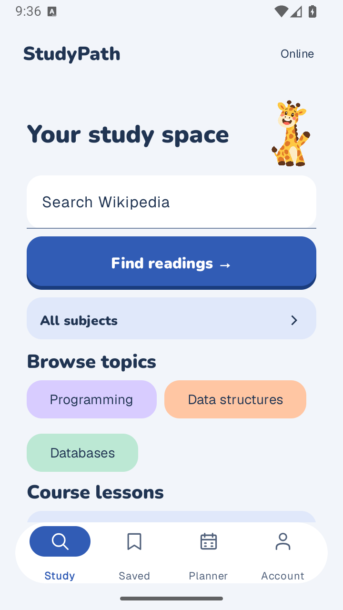
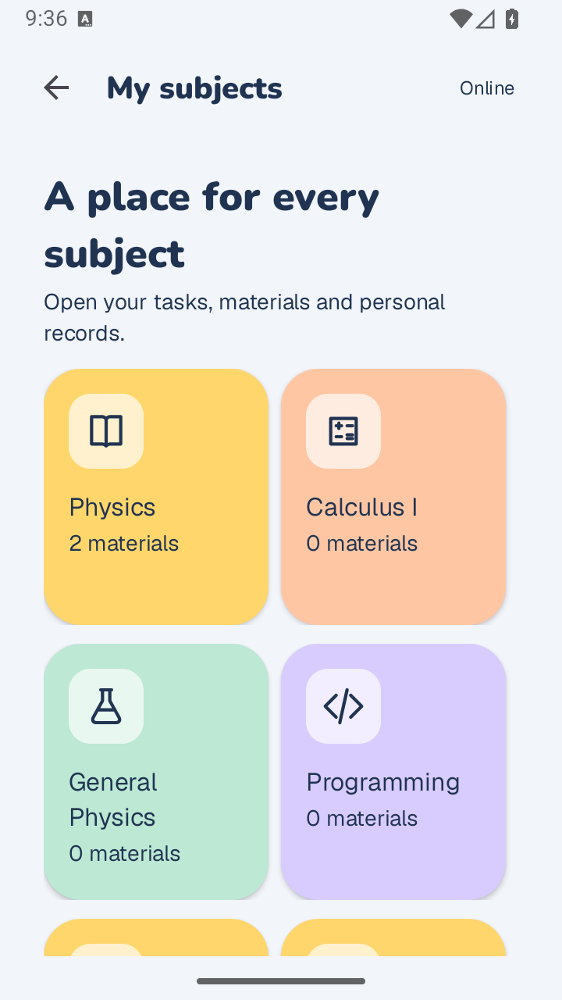

# StudyPath

A native Android study companion for discovering references, saving readings offline, working through lessons, and planning academic progress.

**[Download StudyPath 0.1.6 APK](https://github.com/marina21-cs/StudyPath/releases/download/v0.1.6/StudyPath.apk)** · [Release notes](https://github.com/marina21-cs/StudyPath/releases/tag/v0.1.6) · [All releases](https://github.com/marina21-cs/StudyPath/releases)

> **Testing prerelease:** Tide Play, version **0.1.6 (7)**, prepared 5 November 2026. Requires **Android 8.0 or newer**. This is a signed debug APK for evaluation. Tide colors, expressive subject tiles, giraffe guidance, and reviewed COR scanning work alongside personal subjects, tasks, study cards and PDFs. The hosted course catalog is currently empty.

<p>
  
  
</p>

## Install the APK

1. Download **StudyPath.apk** using the link above.
2. Open the downloaded file on your Android phone. If prompted, allow installation from the browser or Files app you used.
3. Tap **Install**, or **Update** if StudyPath is already installed.
4. Open StudyPath and sign in or create an account. An internet connection is needed for account access and live reference searches.

When updating, keep your existing app data and original account. If Android reports a signing conflict, preserve your saved work and report the message before removing the existing app. The current prototype binds offline data to one account per installation.

To share the download, send this link:

```text
https://github.com/marina21-cs/StudyPath/releases/download/v0.1.6/StudyPath.apk
```

The APK is **57,130,367 bytes** (about 54.5 MiB). Verify it with the [SHA-256 checksum](docs/releases/SHA256-v0.1.6.txt):

```text
ec26e3c29a2fb26abfe71febc5f96662620ab27c70773a03bebd9314dad0aa1f
```

## Features

- **Discover:** search Wikipedia and read attributed references or paginated full-article text.
- **Save:** keep reading snapshots, private notes, and reading position for offline access.
- **Learn:** choose a study level and subjects; download available approved lessons with practice, explanations, and progress tracking.
- **Import COR:** crop course names from PDFs/images, recognize text on-device, correct and review names, then find suggested readings or open a PDF/module web search.
- **Organize:** create personal subjects, tasks, and study cards, and import PDFs for native offline reading.
- **Plan:** see unfinished personal tasks; record scores, explore grade/GWA scenarios, and check prerequisites under the configured academic rules.
- **Return:** organize study reminders and optional controlled family summaries.

Personal subjects, tasks, authored lessons, and PDFs stay on this phone and are **not cloud backed up**. They survive normal app updates; uninstalling or clearing app data removes them. Personal task dates do not schedule notifications. Full-article offline availability is not guaranteed.

Wikipedia references and demonstration lessons are separate from approved instructional content. Academic calculations depend on the applicable configured policy; they do not establish official institutional results.

## Current release status

Release-specific build, native device and signing evidence is recorded in the [verification summary](docs/releases/v0.1.6.md). See the [phone checklist](docs/releases/v0.1.6-phone-checklist.md) and [Tide design contract](docs/design/tide-play.md). These checks do not establish every feature or production cloud workflow.

The downloadable APK connects to the configured Firebase cloud backend. A source checkout defaults to local Firebase emulators. Published lessons are unavailable in the current cloud catalog. The original physical-phone issue, older cache recovery, broader accessibility, and final cloud acceptance remain open.

## Build from source

Use **Android Studio**, **Android SDK 36**, and a **JDK compatible with Gradle 8.13** (17 or newer). Local Firebase tooling additionally requires **Node.js 24.12+** and **Java 21**.

```sh
git clone https://github.com/marina21-cs/StudyPath.git
cd StudyPath/android
./gradlew --max-workers=2 --no-parallel :app:testDebugUnitTest :app:assembleDebug
```

The debug APK is generated at `android/app/build/outputs/apk/debug/app-debug.apk`. To use accounts in this default local build, start and seed the Firebase emulators using the [backend setup guide](backend/README.md), then install through `android/run-local.sh`.

- [Android setup, local device workflow, and cloud configuration](android/README.md)
- [Firebase setup, schema, seed data, and tests](backend/README.md)
- [Personal workspace behavior and limits](docs/implementation/personal-study-workspace.md)
- [Personal data architecture](docs/architecture/personal-study-data.md)
- [Release and Git maintenance](docs/PUBLISHING.md)

## Technology and layout

| Component | Implementation |
| --- | --- |
| Android application | Kotlin, XML Views, ViewBinding, ViewModels and repositories |
| Accounts | Firebase email/password Authentication |
| Persistence | Firebase Realtime Database and account-owned local state |
| Background reminders | Android WorkManager |
| Reference discovery | Wikipedia / MediaWiki API |
| Verification | JVM unit tests, Firebase emulator rules tests, native device smoke |

```text
android/         Native app, resources, Gradle wrapper, and tests
backend/         Database rules, schema, synthetic fixtures, and tooling
docs/            Setup references, screenshots, and release records
implementation/  Phase-plan input used by the backend verification runner
```

Machine configuration, signing keys, account exports, raw device reports, imported agent tools, and old APK packages are excluded from the public source. APK downloads live in GitHub Releases.

## Feedback and attribution

Report reproducible problems through [GitHub Issues](https://github.com/marina21-cs/StudyPath/issues), including your Android version, StudyPath version, and steps to reproduce. Keep passwords and personal account data out of reports.

This is a student project under active development. No project-wide open-source license has been selected. Bundled fonts retain their [individual licenses](android/app/src/main/assets/licenses); Wikipedia content retains its source attribution and applicable license.
