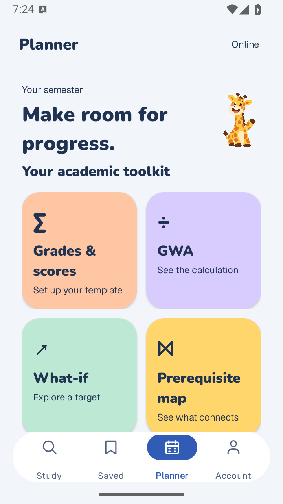

# StudyPath 0.1.7 — Tide Play academic toolkit

Phone-testing prerelease, 6 November 2026. [Download StudyPath.apk](https://github.com/marina21-cs/StudyPath/releases/download/v0.1.7/StudyPath.apk). Install as an update using your existing account.

## Changes

- Planner begins with four colored destinations: Grades & scores, GWA, What-if and Prerequisite map, even with no published course pack. The giraffe appears beside the Study and Planner greetings.
- Persistent subject grading drafts: editable categories, weights, aggregation and assessments, raw GradeEngine estimates, external review-copy preparation and explicit reviewed-course linking. Zero and ungraded remain distinct.
- GWA inclusion controls with weighted arithmetic and common-scale confirmation; separate hypothetical exam/target calculations; a connected personal course graph and equivalent list.
- Paste an HTTPS PDF link, review title/subject, download with progress/cancel/retry, then open the validated file offline. Android Share accepts PDF links and PDF content URIs. Existing device import and study cards remain.
- Clean Wikipedia article extraction removes infobox/sidebar/navigation/citation clutter. Saved excerpts can open a separate cleaned live article while preserving their original notes and position.
- Tide blue raised actions, rounded local fonts, yellow resume/progress surface, expressive subject cards and the existing guided COR crop/OCR/review/recommendation flow.

## Slide-to-Android coverage

The localhost deck is a design reference. Native layouts adapt to phone size and real records; illustrated grades, subjects, approved policies and lessons are not inserted into users’ data.

| Slide family | APK route and implementation |
| --- | --- |
| Welcome, sign-in, registration, preferences | Existing native auth and onboarding activities/fragments; Tide styling and giraffe retained. |
| Selected slide 32 / Study | Study tab: greeting, compact search, yellow resume/progress, personal subject rows, colored topics, floating navigation. Resume appears when there is retained work. |
| Subject tiles / empty subjects | Study → All subjects; colored native tiles and add-subject/COR actions. |
| Tasks, materials, grades | Open a subject from Study, Saved or Planner; all use the same local subject ID and records. |
| Reading, source, notes, saved shelves | Search → Reading; original source/revision/license, notes/place and saved-copy state retained. |
| PDF and study cards | Subject → Materials; native page navigation/zoom/jump and question/answer cards. |
| COR and recommendations | Planner → Import COR; choose PDF/image/page, adjust crop, recognize, edit, review, add selected subjects, find materials. |
| Lessons and practice feedback | Course packs → published lesson; existing worked steps, checks, feedback and brief giraffe celebration. Requires actual published content. |
| Planner and slide 35 | Always-visible four-tile academic toolkit, semester subjects and upcoming tasks. |
| Grade/template/review, slide 36 | Planner → Grades & scores → template; draft editor, persisted scores, prepare/share review copy. Approval is not granted by students. |
| GWA and scenario, slide 37 | Planner → GWA / What-if; course inclusion, formula and separate scenario assumptions. |
| Prerequisite map/list, slide 38 | Planner → Prerequisite map; connected focusable nodes, horizontal pan, details/edit and equivalent list. Personal edges require all selected courses; official policy remains unknown until reviewed. |
| PDF link flow, slide 39 | Subject → Materials → Paste PDF link; source/title/subject review, actual bounded download, offline completion. |
| Clean reading / recovery, slide 40 | Fresh Wikipedia extraction; saved-reading clean-copy action; failed PDF download → Retry / Edit link. |
| Account, reminders, family, storage/privacy | Existing Account and storage routes remain. Family sharing and policy-bound operations keep their authorization/status gates. |

## Verification and identity

- Final native build: exit 0. **504 JVM tests in 56 suites**, zero failures/errors/skips.
- `android/test-device.sh emulator-5554 --live-api --personal-workspace`: exit 0, explicit **OK (1 test), 142.676 seconds**, isolated read-only StudyPath_Lite_Test with local seeded Firebase.
- Observed native flows: registration/sign-in/logout, live Wikipedia/save/reopen/pagination, subject/task/material persistence, PDF navigation, COR crop/OCR/review, draft 16/20 → 80%, recreation persistence, GWA 1.75, scenario 75%, graph/list, toolbar/back navigation, invalid URL, failed download without a phantom offline item, successful linked-PDF validation/save/reopen.
- Actual extractor against captured DeepSeek revision 1382597292 produced article prose without its leading sidebar. Final Planner, grade, graph and PDF screenshots were inspected.
- Local tested APK SHA-256: `c122817e8cc1aa5f0c27e8cdbef2f45e5a94ae780565ea1cba3a2a0bd4711ab4`.
- [Commands, repairs and evidence](../../implementation/phases/03-validation/feedback-017/README.md).

[Native grade screen](../images/tide-grades.png) · [Native connected map](../images/tide-prerequisite-map.png)

## Download identity

| Field | Value |
| --- | --- |
| Package | `com.studypath.app` |
| Version | 0.1.7 (8) |
| Minimum / target | Android 8.0 (API 26) / API 36 |
| Build | Cloud-configured signed debug APK |
| Bytes | 57,203,034 |
| SHA-256 | `48e8959d3c25ee3f75c30f2323671a04ed00744172d2200b7ec35bff394c874c` |
| Signing certificate SHA-256 | `9d573838eb0968cd1e0f63a71f61d67f811a38cd4c52265407c1b28f33b79605` |
| Checksum | [SHA256-v0.1.7.txt](SHA256-v0.1.7.txt) |

The signer matches 0.1.6. The cloud build exited 0 with emulator mode false; all 299 Android source hashes match the tested local source. `apksigner verify --print-certs` and `aapt dump badging` exited 0. Cloud-authenticated behavior remains a phone-test check.

## Explicit boundaries

Personal templates are unapproved drafts. Real professor approval, official grade conversions, retake/exclusion decisions and enrollment eligibility require trusted reviewed policy. Sharing a review copy sends nothing until the user chooses an external recipient/app. Existing policy-bound tools keep their guards. The personal graph does not infer passed/completed states from unreviewed grades.

Personal subjects, drafts and PDFs stay on this device without cloud backup. Downloads cancel when leaving the screen; background resume is not implemented. Shared-file providers, interrupted/cancelled transfers, 200% text/TalkBack, physical airplane-mode/process-death recovery and real COR layouts need broader phone testing. Full Wikipedia articles still require connectivity; old saved excerpts are not rewritten automatically.

This is a signed debug prerelease for testing, not final B07/B08 or production-cloud acceptance. No Firebase rules, production catalog or cloud services were deployed by this release.
